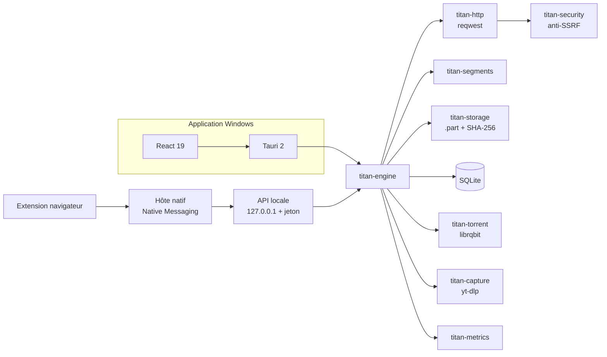

<p align="center">
  
</p>

<p align="center">
  <strong>Le gestionnaire de téléchargements Windows : rapide, local et sans compromis.</strong>
</p>

<p align="center">
  
  
  
  
  
  
  
</p>

**Titan Download Manager** est une application de bureau Windows qui réunit
téléchargement **HTTP segmenté**, **BitTorrent**, **capture de médias** et
**intégration au navigateur** dans une seule interface. Le moteur est écrit en
**Rust**, l'interface en **Tauri 2 + React**, et tout fonctionne **en local** :
aucun compte, aucun serveur distant, aucune télémétrie.

L'état réel de chaque fonctionnalité — y compris ce qui n'est pas encore terminé —
est documenté dans [`FEATURE_STATUS.md`](FEATURE_STATUS.md).

---

## Pourquoi Titan

- **Un vrai moteur de téléchargement** : segmentation HTTP, reprise après pause
  ou redémarrage, nouvelles tentatives avec backoff et respect de `Retry-After`,
  miroirs, limites de débit et vérification SHA-256.
- **Tout au même endroit** : HTTP(S), torrents, vidéos et fichiers interceptés
  depuis le navigateur, avec une file d'attente, des catégories et un historique.
- **Local par défaut** : secrets chiffrés avec DPAPI (compte Windows), API locale
  sur `127.0.0.1` protégée par jeton, aucune donnée envoyée à un tiers.
- **Une interface honnête** : les fonctions inachevées sont désactivées et
  marquées « bientôt » — pas de bouton factice ni d'indicateur simulé.

## Fonctionnalités

| Domaine | Ce que Titan apporte |
|---|---|
| **HTTP(S)** | Téléchargement segmenté (requêtes `Range` / `206`), pause et reprise sans corruption, reprise après redémarrage, retries avec backoff et `Retry-After`, miroirs, limites de débit globales et par tâche, fichiers sans `Content-Length`, SHA-256 et renommage atomique `.part` → destination. |
| **BitTorrent** | Magnets et fichiers `.torrent` via librqbit, sélection des fichiers, pause/reprise, suppression. **Mode anonyme** optionnel : trafic TCP pairs/trackers routé par un proxy SOCKS5 (Tor ou I2P), DHT/uTP/LSD et écoute entrante désactivés. |
| **Capture média** | Téléchargement via yt-dlp (YouTube, TikTok, Twitch, X, Instagram…), analyse des métadonnées sans téléchargement, choix de la qualité, pause/reprise, installation de yt-dlp en un clic. |
| **Navigateur** | Capture directe au clic avant tout téléchargement, bouton **Titan** au survol des vidéos (page envoyée à yt-dlp), flux de secours par l'API `downloads`, menus contextuels, restauration automatique dans le navigateur si Titan est indisponible. Chrome, Edge, Brave et Firefox. |
| **Interface** | Vues Téléchargements, Torrents, Médias, Catégories, Historique et Paramètres ; panneau de détails (segments, sources, historique, vérification) ; performances en temps réel ; 6 thèmes ; détection matérielle et optimisation des connexions ; icône de zone de notification ; notifications Windows ; interface en français. |
| **Données** | SQLite en mode WAL, sauvegarde automatique quotidienne (7 copies), restauration automatique si la base manque au démarrage, cookies et en-têtes sensibles chiffrés au repos, historique des téléchargements et benchmarks. |

## Architecture



Le workspace Rust est découpé par responsabilité : le moteur ne dépend pas de
l'interface, et toute la logique réseau, de stockage et de persistance est
testable indépendamment de Tauri. L'extension navigateur ne parle jamais
directement au réseau : elle passe par un hôte natif (stdin/stdout) puis par
l'API locale authentifiée.

## Compiler et installer

Prérequis : **Windows 10/11 x64**, **Rust stable (toolchain MSVC)**, **Node.js ≥ 20**
et **WebView2**.

```powershell
# Depuis la racine du dépôt : hôte natif requis par `tauri dev`
cargo build --release -p titan-native-host

# Interface et application
cd apps/desktop
npm install
npm run tauri dev    # développement avec rechargement
npm run tauri build  # installeurs MSI + NSIS
```

Les artefacts sont produits dans `target\release\bundle\msi\` et
`target\release\bundle\nsis\`. Le NSIS est **per-user** (mises à jour sans droits
administrateur) ; le MSI est per-machine et demande une élévation.

## Extension navigateur

1. Compilez l'hôte natif : `cargo build --release -p titan-native-host`.
2. Dans Titan : **Paramètres → Extension navigateur → Installer l'hôte natif**
   (Chrome, Edge, Brave, Firefox — aucun droit administrateur).
3. Chargez l'extension depuis la page ouverte par Titan :
   - **Chrome / Edge / Brave** : mode développeur → « Charger l'extension non
     empaquetée » → dossier `%LOCALAPPDATA%\Titan\browser-extension`.
   - **Firefox** : « Charger un module temporaire » → `manifest.json` du
     sous-dossier `firefox/` (installation permanente soumise à signature AMO).

Détails, limites et installation manuelle :
[`apps/browser-extension/README.md`](apps/browser-extension/README.md).

## Sécurité et vie privée

- **Anti-SSRF** : les hôtes privés sont refusés par défaut ; l'option
  `allow_private_hosts` doit être activée explicitement.
- **API locale** : écoute uniquement sur `127.0.0.1`, jeton aléatoire dans
  `%APPDATA%\Titan\bridge.json`, comparaison à temps constant, limite de débit et
  allowlist d'origine pour les extensions.
- **Secrets au repos** : cookies, referrer, en-têtes personnalisés et mot de passe
  proxy chiffrés par **DPAPI** (lié au compte Windows) ; ils ne sont rejoués que
  pour le téléchargement concerné.
- **Données** : sauvegarde quotidienne automatique dans
  `%LOCALAPPDATA%\Titan\backups` (7 copies, hors du dossier supprimé par le
  désinstalleur).
- **Mode anonyme BitTorrent** : tout le trafic TCP pairs/trackers passe par le
  proxy SOCKS5 ; les trackers UDP ne sont pas couverts par SOCKS5, préférez
  HTTP(S).
- **Aucune télémétrie**, aucun compte, aucun service cloud.

## Qualité et tests

Dernière campagne de vérification : **21 octobre 2026**.

| Vérification | Résultat |
|---|---|
| `cargo check --workspace` | 0 erreur, 0 avertissement |
| `cargo test --workspace` | **126 tests verts** (118 unitaires + 8 bout-en-bout) |
| `cargo test -p titan-engine --test e2e_http` | HTTP réel, 16 Mio, pause/reprise et redémarrage sans corruption |
| `cargo test -p titan-capture` | yt-dlp réel : analyse, téléchargement, pause/reprise |
| `cargo test -p titan-torrent --test proxy_e2e` | Annonce tracker via un proxy SOCKS5 local |
| `npx tsc` + `npx vite build` | TypeScript strict sans erreur, build frontend OK |

```powershell
cargo test --workspace
cargo test -p titan-engine --test e2e_http
cargo test -p titan-torrent --test proxy_e2e
```

Le test de capture (`cargo test -p titan-capture`) nécessite un `yt-dlp.exe`
réel dans le `PATH`.

## État du projet et feuille de route

Titan assume ses limites : [`FEATURE_STATUS.md`](FEATURE_STATUS.md) distingue
clairement **implémenté et testé**, **implémenté à valider en usage réel** et
**non implémenté**. Le détail des bugs trouvés et corrigés pendant la campagne
bêta est dans [`BETA_TEST_REPORT.md`](BETA_TEST_REPORT.md).

Prochains chantiers :

- validation terrain de la capture au clic et de la capture vidéo YouTube dans
  un vrai Brave/Chrome, puis des palettes Minuit/Océan/Braise ;
- détection de média (« Grabber ») et planificateur horaire ;
- internationalisation de l'interface ;
- mise à jour automatique et signature de code ;
- interception des liens magnet dans l'extension (impossible via l'API
  `downloads` du navigateur).

## Structure du dépôt

```text
crates/
  titan-engine/        cycle de vie des tâches, file d'attente, reprise, limites
  titan-http/          client HTTP, capacités, retries, Retry-After
  titan-segments/      planification et suivi des segments
  titan-storage/       fichiers .part, SHA-256, renommage atomique
  titan-db/            SQLite (sqlx), migrations, chiffrement DPAPI
  titan-security/      anti-SSRF, validation d'URL, noms de fichiers
  titan-metrics/       concurrence adaptative, débit, diagnostics
  titan-torrent/       pont librqbit (magnet et .torrent)
  titan-capture/       capture média via yt-dlp
  titan-api/           API locale authentifiée
  titan-core/          types et primitives partagés
apps/
  desktop/             Tauri 2 + React 19
  browser-extension/   Manifest V3 Chromium + variante Firefox
native-host/           hôte Native Messaging
docs/assets/           bannière du projet
```

## Contribuer

Les issues et pull requests sont bienvenues. Avant de proposer un changement,
consultez `FEATURE_STATUS.md` pour éviter de dupliquer un chantier en cours, et
assurez-vous que `cargo test --workspace` ainsi que `npx tsc` passent.

## Licence

Titan Download Manager est distribué sous **double licence MIT ou Apache-2.0**,
au choix.
